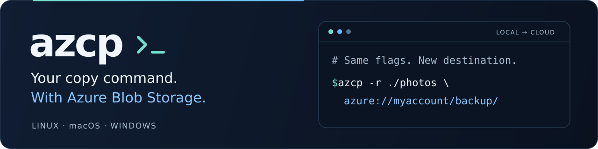

# azcp



[](https://github.com/JohanLindvall/azcp/actions/workflows/ci.yml)
[](https://github.com/JohanLindvall/azcp/releases/latest)
[](https://pkg.go.dev/github.com/JohanLindvall/azcp/cmd/azcp)
[](LICENSE)

**Copy local files and Azure blobs with the commands you already know.**
`azcp` brings GNU `cp` syntax to Azure Blob Storage, with parallel transfers,
remote wildcards, resumable transfers and a live progress display. One binary
for Linux, macOS and Windows.

```sh
# Upload a directory to an existing container.
azcp -r ./photos azure://myaccount/backup/
```

Use your account and container in place of `myaccount` and `backup`.
Already signed in with `az login`? azcp can use that session. SAS tokens,
managed identities and interactive sign-in work too.

[Install](#installing) · [Quick start](docs/quickstart.md) · [Examples](#everyday-examples) · [Documentation](docs/README.md) · [Contribute](CONTRIBUTING.md)

For a Norton Commander-style file manager, run `azcp --tui [LEFT [RIGHT]]`.
Browse local and Azure folders in two panes, copy, move, preview and delete
files, or organize locations in [nested virtual containers](docs/tui.md). The normal
command line remains compatible with `cp`.

<a id="getting-started"></a>

## Installing

**Linux and macOS**

```sh
curl -sSfL https://raw.githubusercontent.com/JohanLindvall/azcp/main/scripts/install.sh | sh
```

The [installer](https://github.com/JohanLindvall/azcp/blob/main/scripts/install.sh)
checks the release's SHA-256 checksum and installs to `~/.local/bin`
(`/usr/local/bin` as root). Follow its instructions if that directory needs
adding to your `PATH`, then run `azcp --version`.

**Windows:** download and extract the matching ZIP from the
[latest release](https://github.com/JohanLindvall/azcp/releases/latest), then
run `.\azcp.exe --help` in PowerShell. Add its directory to your `Path` to
use `azcp` anywhere.

**With Go 1.26.0 or newer:**

```sh
go install github.com/JohanLindvall/azcp/cmd/azcp@latest
```

[All installation options](docs/installation.md) include Docker, manual
downloads, checksum verification and building from source.

<a id="trying-it-without-an-account"></a>

No Azure account? [Try a local copy](docs/quickstart.md#try-it-locally), or
[upload and download with the local emulator](docs/quickstart.md#try-blob-storage-without-an-azure-account).
Both walkthroughs create their own sample files.

## Why azcp?

- **Familiar commands.** Use `-r`, `-n`, `-u`, `-a` and the rest of GNU `cp`'s
  interface. Local paths and blob URLs work on either side of the copy.
- **Find the files you want.** Use `**`, `{a,b}`, extended patterns and
  include/exclude filters across local paths and remote blob names.
- **Keep transfers moving.** Parallel files and blocks, retries, resume and a
  progress display make large copies easier to manage.
- **Fit it into your workflow.** Stream from pipes, compress on upload, expand
  on download, cap bandwidth or emit JSON for scripts.
- **Avoid unnecessary requests.** Recursive blob scans use flat listings;
  plain uploads skip a destination lookup when no option needs one.

The compatibility reference is GNU `cp` 9.4. See the documented
[differences](docs/guide.md#differences-from-cp), including special files,
SELinux contexts and platform-specific attribute support.

## Everyday examples

Replace `myaccount` with your account name. These examples assume the source
files and destination containers exist. To create a missing container, add
`--create-container` with a credential allowed to create it.

**Download matching files.** Quote patterns so azcp can expand them remotely.
Create the local directory first when a pattern can select multiple files.

```sh
mkdir -p archive
azcp 'azure://myaccount/logs/**/*.gz' ./archive/
```

**Upload a tree, leaving out generated files.** `-T` puts the contents directly
in the named destination tree, including on repeat runs.

```sh
azcp -rT --exclude 'node_modules/**' --exclude '*.log' \
  ./app azure://myaccount/releases/app
```

**Pick up an interrupted download.** Use `--resume` from the first run. Rerun
the same command to finish partial files and skip those already downloaded.

```sh
azcp -rT -n --resume azure://myaccount/data/dataset ./dataset
```

**Compress on upload, expand on download.** Each file is stored separately;
`report.csv` becomes `report.csv.zst` with its content encoding set.

```sh
azcp -rT --compress=zstd ./reports azure://myaccount/archive/reports
azcp -rT --decompress azure://myaccount/archive/reports ./restored-reports
```

**Preview a copy between accounts.** Remove `--dry-run` when the destination
paths look right. azcp uses server-side copy routes where available.

```sh
azcp --dry-run -rT azure://sourceaccount/data/photos \
  azure://destinationaccount/backup/photos
```

See the [destination-path examples](docs/quickstart.md#understand-the-destination)
for how existing directories affect the result, or the
[user guide](docs/guide.md) for authentication, checksums, pipes and all options.

<a id="why-not-azcopy"></a>
<a id="compared-with-azcopy"></a>

## azcp or AzCopy?

Choose azcp when you want the `cp` command line, local-to-local copies and
path patterns that work with blob storage. AzCopy is a good fit when you need
its job management, sync command or other storage services.

Request efficiency is one reason to try azcp. The project's recorded
comparison with AzCopy 10.32.7 includes:

| Workload | azcp | AzCopy |
| --- | ---: | ---: |
| Requests to upload 500 × 8 KiB files | **503** | 1,000 |
| Listing requests for a tree with 341 directories | **2** | 103 |

These are historical results for specific workloads, not a promise of
throughput on your account. Read the [measurement context and tradeoffs](docs/comparison.md),
or use the [migration guide](docs/azcopy.md) to translate familiar commands.

## Documentation

| Start here | Go deeper |
| --- | --- |
| [Install](docs/installation.md) | [Authentication](docs/guide.md#signing-in) |
| [First copy](docs/quickstart.md) | [Patterns and filters](docs/guide.md#choosing-what-to-copy) |
| [AzCopy migration](docs/azcopy.md) | [Resume](docs/guide.md#interrupted-transfers) |
| [Performance and tradeoffs](docs/comparison.md) | [Full option reference](docs/guide.md#options) |

[Browse all documentation](docs/README.md). Run `azcp --help` for the options
supported by your installed version.

## Help make it better

Found a bug or a confusing example? [Open an issue](https://github.com/JohanLindvall/azcp/issues/new/choose).
Documentation improvements, reproducible bug reports and platform testing are
welcome; [Contributing](CONTRIBUTING.md) explains how to get started without
an Azure account. Report vulnerabilities through the
[private security channel](SECURITY.md).

If azcp is useful to you, **give it a star** so you can find it again, or share
it with someone who copies data to Azure. To hear about new versions, use
GitHub's **Watch → Custom → Releases**.

Maintained by [Johan Lindvall](https://github.com/JohanLindvall).
Using azcp in research? [Citation metadata](CITATION.cff) is available.

## License

[MIT](LICENSE).

<details>
<summary>Links to sections from the earlier README</summary>

The detailed reference has moved into the documentation. These anchors keep
existing links useful.

| Section | New location |
| --- | --- |
| <a id="how-to-migrate"></a><a id="commands"></a><a id="flags"></a><a id="urls-and-credentials"></a><a id="worked-examples"></a><a id="what-has-no-counterpart"></a>Migration | [Moving from AzCopy](docs/azcopy.md) |
| <a id="locations"></a>Locations | [Location syntax](docs/guide.md#locations) |
| <a id="pipes"></a>Pipes | [Streaming](docs/guide.md#pipes) |
| <a id="signing-in"></a>Signing in | [Authentication](docs/guide.md#signing-in) |
| <a id="choosing-what-to-copy"></a>Choosing what to copy | [Filters](docs/guide.md#choosing-what-to-copy) |
| <a id="archiving-a-tree"></a>Archiving a tree | [Attributes](docs/guide.md#archiving-a-tree) |
| <a id="verifying-a-copy"></a>Verifying a copy | [Checksums](docs/guide.md#verifying-a-copy) |
| <a id="compressing-on-the-way"></a>Compressing on the way | [Compression](docs/guide.md#compressing-on-the-way) |
| <a id="limiting-bandwidth"></a>Limiting bandwidth | [Bandwidth](docs/guide.md#limiting-bandwidth) |
| <a id="keeping-a-destination-in-step"></a>Keeping a destination in step | [Updates and deletion](docs/guide.md#keeping-a-destination-in-step) |
| <a id="interrupted-transfers"></a>Interrupted transfers | [Resume](docs/guide.md#interrupted-transfers) |
| <a id="wildcards"></a>Wildcards | [Patterns](docs/guide.md#wildcards) |
| <a id="transfers"></a>Transfers | [Transfer behavior](docs/guide.md#transfers) |
| <a id="progress"></a>Progress | [Terminal display](docs/guide.md#progress) |
| <a id="machine-readable-output"></a>Machine-readable output | [JSON](docs/guide.md#machine-readable-output) |
| <a id="measuring-the-link"></a>Measuring the link | [Benchmark](docs/guide.md#measuring-the-link) |
| <a id="logging"></a>Logging | [Logs](docs/guide.md#logging) |
| <a id="options"></a>Options | [Option reference](docs/guide.md#options) |
| <a id="differences-from-cp"></a>Differences from cp | [Compatibility](docs/guide.md#differences-from-cp) |
| <a id="layout"></a>Layout | [Project layout](CONTRIBUTING.md#finding-your-way-around) |

</details>
