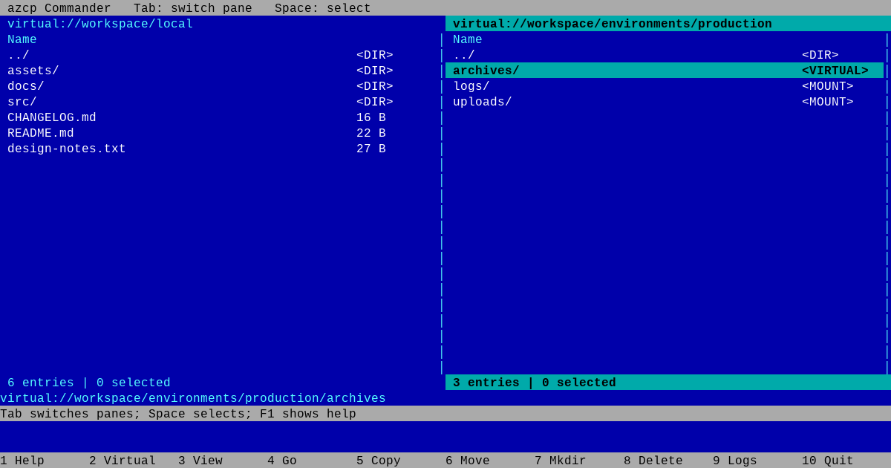
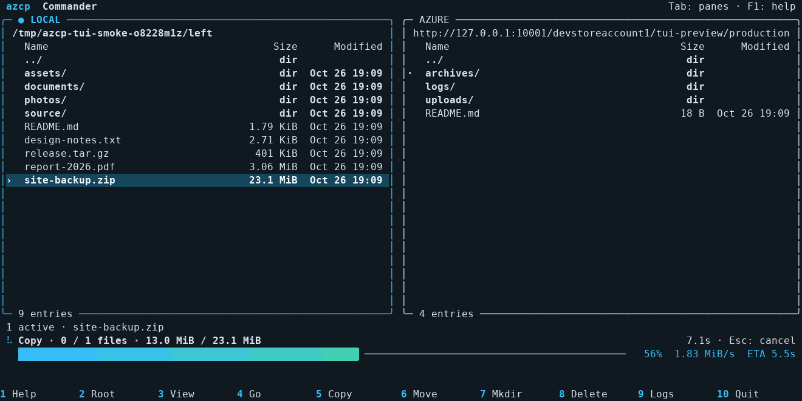

# Two-pane file manager



Start the Norton Commander-style interface explicitly:

```sh
azcp --tui
azcp --tui ./photos azure://myaccount/backup
azcp --tui --create-container . azure://myaccount
azcp --tui=single azure://myaccount
azcp --tui=usage /path/to/analyze
azcp --tui=usage azure://myaccount/backup
```

The optional operands set the left and right starting directories; each defaults
to the current directory. Ordinary `azcp SOURCE DEST` commands keep their `cp`
behavior, and an invocation without operands still reports a missing operand.
Both stdin and stderr must be terminals.

`--tui=single` opens one full-width pane for browsing and deleting; see
[single-pane mode](#single-pane-mode). `--tui=usage` starts a live disk-usage scan and opens a full-width view of the
results. In the ordinary two-pane view, **u** scans the active directory and
opens the same view; **u** returns to the file manager. No recursive scan runs
unless you request one. `--tui=commander` is equivalent to plain `--tui`.

The panes use your terminal's background with the same blue and green accents
as the `cp` progress display. A highlighted row and `›` identify the cursor;
`●` marks selections. Sizes are aligned, and wider windows also show modified
times. `NO_COLOR` (including an empty value) or `CLICOLOR=0` removes colors while
keeping the cursor, marks and dialog borders visible.

During a transfer, the status area shows file and byte totals, the active file,
a gradient progress bar, average throughput and an estimated time remaining.
Scanning uses an indeterminate bar until the totals are known. Failures, retries
and skips stay visible when the window narrows. The display updates once a
second during work; keyboard input and resizing update it immediately.



## Azure as a directory tree

An Azure account opens as a directory of storage containers. Open a container
to see its blobs and virtual directories. Blob prefixes become directories at
as many levels as the blob names contain:

```text
azure://myaccount/
└── backups/                    storage container
    └── projects/               virtual directory
        └── website/            virtual directory
            ├── assets/         virtual directory
            │   └── logo.png    blob
            └── README.md       blob
```

For example, `projects/website/assets/logo.png` is the blob's key within the
`backups` container. The panes expose each component as a folder, so Enter,
Backspace, selection, recursive copy, move and delete work like they do on a
local directory tree. No additional configuration is needed. Either pane can
point to local storage or any accessible Azure account, container or prefix.
If a blob shares a name with a prefix, both appear as separate entries (`name`
and `name/`), so neither object is hidden.

F7 creates a directory at the current level, including inside an existing
virtual directory. Azure empty directories are represented by zero-byte marker
blobs ending in `/`, so they survive refreshes and copies. Creating an actual
storage container at the account root requires `--create-container`.

The interface uses the existing copy engine, credentials, parallel transfers
and retry policy. Azure sign-in instructions appear beneath the panes and in
the message viewer. The same credentials and connection pool are reused for
the session. Listings and operations run in the background so cancellation
remains available during a slow request. SAS tokens stay redacted on screen.

## Keys

| Key | Action |
| --- | --- |
| Tab | Switch pane |
| Up / Down, Home / End, Page Up / Down | Move the cursor |
| Enter / Right | Enter a directory or preview a file |
| Backspace / Left | Go to the parent |
| Space / Insert | Toggle selection and advance |
| `*` | Invert selection |
| F1 / `?` | Help |
| F2 / `v` | Go to the current filesystem or Azure container root |
| F3 | Read-only text preview, limited to the first 64 KiB |
| F4 / `g` | Go to a local path or Azure URL |
| F5 / `c` | Copy selected entries |
| F6 / `m` | Move selected entries |
| F7 / `n` | Create a directory |
| F8 / `d` / Delete | Permanently delete selected entries |
| F9 / `l` | Show messages and sign-in instructions |
| Ctrl-R / `r` | Refresh both panes |
| `s` | Sort the active pane |
| `u` | Scan a disk-usage view / return to the two-pane file manager |
| `f` | Toggle the active pane's size / recursive file-count column |
| `/` | Filter the active pane's names; empty input clears the filter |
| `z` | Calculate sizes and file counts for marked directories, or the directory under the cursor |
| Shift-Z / `Z` | Calculate sizes and file counts for all directories in the active pane |
| F10 / `q` | Quit; cancel active work and wait for it to stop |
| Esc / Ctrl-C during an operation | Cancel the operation |

With no marked entries, actions use the entry under the cursor. The parent
entry cannot be selected. Function keys also have letter alternatives for
terminals that reserve those keys. F2 stays inside the current Azure container,
so returning to its root works with a container-scoped SAS.

Copy and move go directly to confirmation using the other pane as the
destination. Press **e** in that confirmation to enter another existing
directory if needed. Relative destinations are resolved from the other pane;
empty input keeps the displayed destination. Use F7 to create a directory
first. Path prompts accept Backspace and Ctrl-U to clear the input.

In the copy, move or delete confirmation, press **y** to proceed;
Enter, **n** and Esc cancel. Copies replace existing destination files and merge
directory contents. Moves copy first and remove sources only after every copy
succeeds, nothing was skipped, the operation was not cancelled, and a fresh
source inventory agrees with the original. A failed copy leaves all move
sources in place, including files already copied successfully.

Moves are copy-and-delete operations, including between local directories;
they are not atomic renames. If source removal fails or is cancelled after it
starts, some sources may already be removed, while their destination copies
remain. Completed changes are not rolled back. Avoid editing files involved
in an active move. Azure blob removals use ETag conditions so a concurrent
replacement is retained.

Recursive deletion lists the entire selection before removing anything and
does not follow local symlinks. Directory deletion removes only that Azure
prefix and its marker, preserving a distinct blob with the same unsuffixed
name. Filesystem roots and Azure accounts cannot be moved or deleted.

Azure containers can be deleted, from an account listing or the usage view,
but not moved. A container is deleted whole, in one request, with whatever it
holds at that moment, including blobs written after the confirmation was
shown; the dialog says so. Its name may be unavailable for re-creation for a
short while afterward, as the service decides. A credential limited to one
container, such as a container SAS, may not delete the container itself;
the error says so and nothing else is removed.

## Live disk-usage analysis

The usage view scans once, then lets you drill down through the cached tree
without more filesystem reads or Azure listings. It starts with the largest
items first, mixing directories and files. Rows show a percentage of the
current directory and, when space permits, a bar relative to the largest item.
Wider terminals show both sizes and recursive file counts. The footer includes
the current directory's totals. All sorting options remain available with **s**.

| Key in the usage view | Action |
| --- | --- |
| Enter / Right, Backspace / Left | Enter a cached directory / return to its parent |
| `a` | Toggle allocated disk space and logical size for local entries |
| `f` | Switch the primary numeric column between size and recursive file count |
| `/` | Filter this directory's names, as in the two-pane view; empty input clears it |
| `i` | Show exact byte counts, type, timestamps, hard links and scan problems |
| `x` | Rescan with filesystem boundaries enforced / crossed (local only) |
| `r` / Ctrl-R | Rescan the original scan root and return to the current directory |
| F8 / `d` | Delete marked entries, or the cursor entry, with confirmation |
| `u` | Return to two panes at the current location |

Local scans start with allocated disk space and cross filesystem boundaries;
**x** switches to one filesystem. They never follow symlinks. Logical totals
include each entry's length, including directory and symlink metadata lengths;
allocated totals use the operating system's disk accounting, including sparse
and compressed files where supported. **H** marks hard links. Each directory
counts a shared inode once, even when its names appear in different descendants.
File counts still count regular-file names, so two hard links count as two files.
Directory overhead and shared hard links mean the visible rows' totals and
percentages need not add up to the parent's total. Allocation is not a promise
of space reclaimed: external hard links or shared filesystem extents can keep
data allocated after a deletion.

Azure uses stored blob lengths, with one flat walk per container and cached
navigation afterward. It exposes neither physical disk allocation nor local
filesystem boundaries. A blob and a prefix sharing a name stay separate, and
significant empty and dot components in blob keys are preserved.

Scans are cancellable with Esc or Ctrl-C. Readable siblings remain available
when a subtree cannot be read: **!** and **?** mark incomplete or unavailable
totals, and **i** or F9 explains the problem. **>** marks an excluded filesystem
or directory alias. An item containing unreadable or excluded entries cannot
be moved or deleted from the usage view. Filtering only hides rows; it does not
change totals or scan scope, and applying a filter clears selection marks.

Confirmed deletion updates the cached tree without rescanning it. Shared
hard-link data remains counted, and Azure virtual folders disappear when their
last blob is removed while explicit directory markers remain. Other cached
panes are invalidated by mutations. Copy, move and mkdir refresh the affected
views; a failed or cancelled mutation returns to live directory listings.
External changes are picked up by **r**. Scans are held in memory for the live
session; there is no saved-scan format.

## Sorting and directory totals

Press **s** to open the sort menu, then **1** for name, **2** for modified time,
**3** for size, **4** for extension, **5** for entry type (directory, file,
special file or symlink), **6** for recursive file count, or **7** for the
newest file inside. Changes apply
immediately; Enter or Esc closes the menu. Inside the menu, **r** reverses the
order and **d** toggles directories
first. Each pane keeps its own settings during navigation and refreshes for the
current session. The pane heading shows the field and direction: ↑ is ascending
(oldest or smallest first), ↓ is descending. The parent stays at the top, and
the cursor and selection marks stay with their entries.

A directory's own modified time says little about its contents, and an Azure
container's says nothing about its blobs. **7** sorts directories by the newest
file anywhere inside, which **z** or **Z** (or a filter that needs it) finds in
the same walk as the totals, and files by their own time. The date column shows
the time the pane sorts by, and is headed **Newest** when that is the newest
file inside. Unmeasured directories sort last. The usage view knows these times
from its scan, and shows a date column in windows 110 columns or wider.

Press **f**, either in the pane or in the sort menu, to switch that pane's numeric
column between **Size** and **Files**. Selecting size or file-count sorting also
shows the corresponding column. Toggling the column leaves the sort unchanged.
Both totals come from the same scan, so switching columns never starts another
scan. The column choice is independent for each pane and lasts for the session.

In the ordinary two-pane view, directory totals are calculated only when
requested with **z** or **Z**. Browsing
and sorting do not start recursive scans. The calculation works for local
directories, Azure prefixes and containers; **z** ignores marked files and uses
the cursor only when nothing is marked. **Z** scans all directories in the active
pane, regardless of marks, sharing a flat listing on Azure rather than listing
each nested prefix separately. Scans show the files and bytes found so far and
can be cancelled with Esc or Ctrl-C.

Totals sum the logical lengths and count of regular files or blobs throughout
the directory and all its subdirectories. Subdirectories themselves do not add
to the file count. Totals do not read file contents, follow symlinks, count
directory metadata or measure allocated disk space. Sparse files count at their full
length and hard links count once per filename. A failed or cancelled scan leaves
the affected totals unknown, rather than displaying partial totals as complete.

An unmeasured directory shows `dir`, a pending calculation shows `…`, and an
empty directory shows `0 B` or `0` after calculation. In the Files column,
individual regular files show `1`; symlinks and special files show `0`.
Size and file-count sorting use completed totals; unknown totals (or unknown
modified times) sort last within their group, in either direction. Results are
snapshots and are cleared by refresh,
navigation, or a copy, move, delete or mkdir operation. Press **z** or **Z** again
to recalculate after external changes.

## Filtering a pane

Press **/** to show only the entries a filter allows. The prompt lists the
syntax, so there is nothing to memorize. Each pane has its own filter, and it
stays in force as that pane moves between directories and refreshes, until
**/** is given empty input (Ctrl-U clears the prompt). The footer shows the
filter and how many listed entries it hides.

A filter is a list of terms separated by spaces:

| Term | Shows |
| --- | --- |
| `report` | names containing the word, ignoring case |
| `*.mp4`, `IMG_????.jpg`, `*.{jpg,png}` | names matching the pattern as bash matches it, case-sensitively |
| `name:TEXT` | the same, for a name that looks like one of the terms below |
| `size>50M`, `size<=1G`, `>50M` | files by length, directories by recursive total |
| `files>=100` | directories holding at least that many files |
| `newer:7d`, `older:2024-01-01` | files by modification time, directories by the newest file inside |
| `has:.mp4`, `has:*.mp4` | directories holding, at any depth, a file whose name matches |
| `type:dir`, `type:file`, `type:link` | entries of that kind |

Any one name term may match; every other term must hold. A leading `-` turns
any term into an exclusion: `*.go -*_test.go` shows Go sources without their
tests, and `-has:*.tmp` hides directories holding temporary files. Quote a
term to include spaces: `"holiday photos"`. Sizes take `K`, `M`, `G` and `T`
(powers of 1024). Times are a date, an RFC 3339 timestamp, or an age such as
`7d` or `36h` before now, as with `--newer-than`. Patterns match one name,
never a path; the parent entry is always shown.

Sizes, file counts, ages and contents of directories come from walking them,
so applying a filter that asks about them measures the directories on show in
one walk, exactly as **Z** does, and answers every `has:` term on the way.
The answers are kept with the directory totals, so entering a measured
directory filters its subdirectories without walking again. A directory that
has not been measured (for example after navigating into one under a new
`has:` term) is kept rather than hidden; **Z** measures it. For example, at an
Azure account root:

```text
/ type:dir size>50M has:.mp4        containers over 50 MiB holding .mp4 files
s 7 r                               newest content first
```

Changing the filter keeps the marks on entries that remain visible and drops
the rest, so nothing out of sight can be copied, moved or deleted. In the
usage view the same filter applies to the current directory and reads the
cached scan, so it never walks again.

## Single-pane mode

`azcp --tui=single [DIR]` opens one full-width pane, for browsing and cleaning
up rather than copying: it lists, previews, sorts, filters, measures and
deletes as the two-pane view does, and shows modified times at any width of
60 columns or more. Copy, move and Tab have nothing to act on and say so.
**u** opens the usage view, and **u** returns to the single pane.

## Transfer options

`--tui` accepts authentication and connection settings, `--jobs`,
`--part-size`, `--part-concurrency`, retry settings, `--bwlimit`, `--timeout`,
`--create-container`, `--put-md5`, `--check-md5`, `--resume`, log settings and
`--dry-run`. Without `--jobs`, each copy or move chooses its own concurrency
as the command line does: up to 4 files at once when both panes are local,
more when Azure is either end. Dry runs permit exploration and confirmation dialogs but do not
copy, move, create or delete files.

Copy-policy flags such as `-i`, `-n`, `-u`, `--exclude`, `--compress`,
`--delete`, and JSON output are rejected with `--tui`. The interface supplies
its own selection and confirmation policy; rejecting these combinations keeps
a move from silently skipping files before removing sources. Use ordinary
`azcp` commands for those policies.
